# ⚡ Awesome Physics Simulation Engine & Game Physics 🎮

**Curated list of commercial SaaS physics platforms, enterprise game physics engines, and high-performance open-source physics solvers.**

*Powering 2D/3D rigid-body dynamics, continuous collision detection (CCD), soft-body deformation, cloth & fluid mechanics, and deterministic rollback multiplayer games.*

[🌐 Sector Overview](#-sector-overview--market-dynamics) • [🏢 SaaS & Commercial Platforms](#-saas--commercial-platforms) • [🔓 Open-Source GitHub Projects](#-open-source-github-projects) • [🤝 Contribution](#-how-to-contribute) • [💖 Support](#-support--community-) • [⭐ Star History](#-star-history) • [📜 Disclaimer](#-disclaimer)

---

## 📌 Introduction & SEO Highlights 🔍

Welcome to the definitive index of **physics simulation engines** and **real-time game physics middleware**. Whether you are building next-generation AAA games with multi-threaded C++ / Rust solvers, creating browser-based WebGPU/WebAssembly simulations, or architecting networked competitive multiplayer games requiring bit-exact deterministic rollback physics, this collection provides audited commercial SaaS solutions and top open-source physics libraries.

### 🎯 Key Focus Areas:
- 🏎️ **Rigid-Body & Multibody Dynamics**: High-throughput solvers, articulated featherstone joints, vehicle suspension systems.
- 💥 **Collision Detection & Raycasting**: Continuous Collision Detection (CCD), SIMD-optimized BVH (Bounding Volume Hierarchies), convex hulls, and V-HACD decomposition.
- 🥋 **Character & Ragdoll Solvers**: Kinematic controllers, inverse kinematics (IK), dynamic ragdoll animations, and skeletal joints.
- 🌊 **Soft Bodies, Cloth & Fluid Simulation**: Extended Position-Based Dynamics (XPBD), SPH (Smoothed Particle Hydrodynamics), and volumetric deformation.
- ⏱️ **Deterministic Multiplayer Physics**: Rollback-compatible lockstep execution, fixed-point math, and reproducible constraint solving.

---

## 📊 Sector Overview & Market Dynamics 📈

The global physics simulation and 3D game engine software market is valued at approximately **$19.5 Billion in 2026** (comprising interactive 3D engines, real-time gaming middleware, and industrial digital-twin engineering simulation software), expanding at a compound annual growth rate (**CAGR) of 14.8%** toward **$35+ Billion by 2032**. 

The sector exhibits **moderate-to-high market concentration** in proprietary entertainment engines (dominated by oligopolistic commercial powerhouses such as Microsoft Havok, Epic Games Unreal Chaos, and Unity Technologies), while maintaining a **highly fragmented, vibrant open-source ecosystem** where specialized independent libraries (e.g., Jolt Physics, Box2D, Rapier) thrive across custom studio engines, indie titles, and emerging Rust/WebGPU tech stacks.

---

## 🏢 SaaS & Commercial Platforms 💼

The following commercial physics platforms, simulation cloud services, and enterprise engine middleware are ranked in descending order by parent company market capitalization / valuation.

| Rank | 🏢 Platform | 🏢 Company / Valuation | 💰 Starting Tier Price | 🎁 Free Tier Limit / Trial Duration | 🛠️ Core Capabilities |
|:---:|:---|:---|:---|:---|:---|
| 1 | **[Microsoft Havok Physics](https://havok.com)** | Microsoft *(~$3.15 Trillion Market Cap)* | **$10,000 / title / platform** (Commercial custom license) | **No perpetual free tier**; Evaluation SDK available upon NDA request for qualified studios (60-day trial) | AAA industry standard 3D rigid-body solver, collision detection, cloth dynamics, and cloud backend simulation. |
| 2 | **[NVIDIA Omniverse & PhysX Cloud](https://nvidia.com)** | NVIDIA *(~$3.00 Trillion Market Cap)* | **$4,500 / year / named user** (Omniverse Enterprise); Core PhysX SDK is Free/Open | **Free forever plan**: Omniverse Individual tier with 2 GPU compute instances and community cloud sync | GPU-accelerated real-time physics, `Blast` fracture destruction, and `Flow` Eulerian fluid grids. |
| 3 | **[Roblox Physics Engine](https://roblox.com)** | Roblox Corporation *(~$28 Billion Market Cap)* | **$0 upfront** (Free engine; 30% developer revenue share on platform monetization) | **Free forever plan**: Unlimited cloud simulation servers, physics replication, and Roblox Studio tools | Cloud-authoritative distributed rigid-body solver and constraint physics engine running at massive scale. |
| 4 | **[Epic Games Unreal Engine Chaos](https://unrealengine.com)** | Epic Games *(~$22.5 Billion Valuation)* | **5% royalty** after $1,000,000 gross lifetime revenue (or $1,850/seat/year for non-gaming enterprise) | **Free forever plan**: Full source access & editor with zero fees until title earns >$1,000,000 USD | High-fidelity real-time destruction fracturing, ragdoll dynamics, cloth simulation, and vehicle systems. |
| 5 | **[Unity Physics & Havok for Unity](https://unity.com)** | Unity Technologies *(~$8.5 Billion Market Cap)* | **$2,040 / seat / year** (Unity Pro required for Havok physics package & enterprise features) | **Free forever plan**: Unity Personal tier for creators with <$100,000 in revenue/funding (Unity Physics included) | DOTS/ECS-native stateless deterministic physics solver paired with commercial Havok runtime integrations. |
| 6 | **[PlayCanvas Physics Cloud](https://playcanvas.com)** | PlayCanvas (Snap Inc.) *(~$16 Billion Snap Market Cap)* | **$15 / seat / month** (Personal tier with private projects and asset storage) | **Free forever plan**: Unlimited public projects with 1 GB cloud storage and browser physics testing | Cloud-hosted collaborative WebGL/WebGPU 3D engine with integrated Ammo.js and Rapier physics solvers. |
| 7 | **[BeamNG.tech Soft-Body Cloud](https://beamng.tech)** | BeamNG GmbH *(~$50 Million Estimated Valuation)* | **€2,400 / license / year** (Commercial simulation & autonomous vehicle proving tier) | **14-day free trial**: Full software evaluation upon application review; no perpetual free tier | Real-time node-beam soft-body vehicle deformation, structural crash physics, and sensor simulation. |
| 8 | **[Algoryx AGX Dynamics](https://algoryx.com)** | Algoryx Simulation AB *(~$25 Million Estimated Valuation)* | **€4,500 / floating license / year** (AGX Dynamics for Unreal / Unity / CAD) | **30-day free trial**: Fully featured evaluation license with technical support; no perpetual free tier | High-fidelity industrial multi-body dynamics, wire ropes, granular bulk material, and heavy machinery physics. |

---

## 🔓 Open-Source GitHub Projects 🌟

A curated selection of the best open-source physics engines, collision libraries, and numerical solvers. Repositories are ranked in descending order by **GitHub Stars** with live stargazer badges.

| Rank | 📦 Project & Repository | 🌟 Star Count | 💻 Primary Language | 🚀 Physics Domains & Solver Highlights |
|:---:|:---|:---:|:---:|:---|
| 1 | **[Godot Engine](https://github.com/godotengine/godot)** |  | C++ | Full-featured 2D/3D game engine featuring built-in discrete physics solvers and modular plug-and-play architecture. |
| 2 | **[Taichi Programming Language](https://github.com/taichi-dev/taichi)** |  | C++ / Python | High-performance parallel computing framework for real-time physical simulation, MLS-MPM, and differentiable fluids. |
| 3 | **[Matter.js](https://github.com/liabru/matter-js)** |  | JavaScript | Popular 2D rigid-body engine for HTML5 web games with sleeping bodies, composite constraints, and canvas renderers. |
| 4 | **[Bullet Physics (`bullet3`)](https://github.com/bulletphysics/bullet3)** |  | C++ | Veteran multi-body dynamics SDK supporting 3D rigid bodies, soft-body deformation, constraints, and OpenCL acceleration. |
| 5 | **[Jolt Physics](https://github.com/jrouwe/JoltPhysics)** |  | C++ | Modern multi-core friendly 3D physics library powering AAA titles (*Horizon Forbidden West*) and Godot Jolt. |
| 6 | **[Box2D](https://github.com/erincatto/box2d)** |  | C | The gold-standard 2D physics engine for games, featuring multithreaded SIMD solver (Box2D v3), continuous collision detection, and joints. |
| 7 | **[Rapier](https://github.com/dimforge/rapier)** |  | Rust | Blazing-fast cross-platform deterministic 2D and 3D physics engine with official WebAssembly, Bevy, and JavaScript bindings. |
| 8 | **[Planck.js](https://github.com/piqnt/planck.js)** |  | JavaScript / TS | 2D JavaScript physics engine rewrite of Box2D designed specifically for web, mobile, and isomorphic node.js environments. |
| 9 | **[Cannon.js](https://github.com/schteppe/cannon.js)** |  | JavaScript | Classic lightweight 3D physics engine written for browser game loops and Three.js scenes. |
| 10 | **[LiquidFun](https://github.com/google/liquidfun)** |  | C++ | Google 2D rigid-body and particle-based fluid dynamics library extending Box2D for interactive liquid mechanics. |
| 11 | **[NVIDIA PhysX SDK](https://github.com/NVIDIA-Omniverse/PhysX)** |  | C++ | Production-grade 3D physics library powering Unreal Engine 4 and Omniverse, featuring artics, vehicles, and cloth. |
| 12 | **[Ammo.js](https://github.com/kripken/ammo.js)** |  | JavaScript / C++ | Direct Emscripten/Wasm compilation of Bullet Physics, bringing industrial C++ 3D rigid and soft-body physics to the web. |
| 13 | **[Avian (formerly Bevy XPBD)](https://github.com/avianphysics/avian)** |  | Rust | ECS-native 2D and 3D physics engine for the Bevy game engine built on Extended Position-Based Dynamics (XPBD). |
| 14 | **[BepuPhysics v2](https://github.com/bepu/bepuphysics2)** |  | C# | Ultra-fast SIMD-accelerated pure C# 3D rigid body physics library optimized for modern .NET runtimes. |
| 15 | **[Godot Jolt](https://github.com/godot-jolt/godot-jolt)** |  | C++ | Drop-in C++ GDExtension replacing Godot 4's native 3D physics engine with high-performance Jolt Physics. |
| 16 | **[Chipmunk2D](https://github.com/slembcke/Chipmunk2D)** |  | C | Lightweight, battle-tested 2D rigid body physics library in C with spatial indexing and fast impulse-based solvers. |
| 17 | **[Cannon-es](https://github.com/pmndrs/cannon-es)** |  | TypeScript | Actively maintained fork of Cannon.js maintained by Poimandres, tailored for React Three Fiber (r3f) web games. |
| 18 | **[SPlisHSPlasH](https://github.com/InteractiveComputerGraphics/SPlisHSPlasH)** |  | C++ | Advanced open-source library for physically-based Smoothed Particle Hydrodynamics (SPH) fluid simulation. |
| 19 | **[ReactPhysics3D](https://github.com/DanielChappuis/reactphysics3d)** |  | C++ | Standalone dependency-free C++ 3D physics library featuring discrete collision detection, joints, and raycasts. |
| 20 | **[V-HACD](https://github.com/kmammou/v-hacd)** |  | C++ | Hierarchical approximate convex decomposition library decomposing concave 3D geometries into optimized collision hulls. |
| 21 | **[Alembic](https://github.com/alembic/alembic)** |  | C++ | Open computer graphics interchange framework for caching baked physical simulations and animated geometry pipelines. |
| 22 | **[Parry](https://github.com/dimforge/parry)** |  | Rust | Standalone 2D and 3D collision detection and geometric queries library in Rust powering the Rapier physics engine. |

---

## 🛠️ Specialized Utilities, Bindings & Extensions 🧩

- 🦀 **Rust Bindings & Crates**:
  - `jolt-physics-rs`: Ergonomic Rust bindings for the Jolt Physics engine.
  - `ggrs`: Good Game Rollback System for deterministic peer-to-peer multiplayer physics.
- 🌐 **Web & JavaScript Wrappers**:
  - `jolt-physics.js`: WebAssembly compilation of Jolt Physics for three.js and Babylon.js.
  - `@react-three/rapier`: Declarative physics components for React Three Fiber.
- 🧮 **Deterministic Math**:
  - `FixedMath.Net` & `cordic`: Fixed-point math arithmetic ensuring cross-platform floating-point determinism in rollback networking.

---

## 🤝 How to Contribute 🚀

Contributions are warmly welcomed! Please help expand and refine this ecosystem:

1. 🍴 **Fork the repository**.
2. 🌿 **Create a descriptive feature branch** (`git checkout -b add-physics-engine`).
3. 📝 **Add entries following the tabular standards**:
   - For SaaS: Include Name, Company/Valuation, Starting Tier Price, Free Tier Limit/Duration, and Features.
   - For Open-Source: Include Name, Language, GitHub link with stargazer badge (`style=social&color=white`), and Core Features.
4. ✅ **Ensure links and markdown syntax are valid**.
5. 📬 **Submit a Pull Request** with a brief summary of the submission.

---

## 💖 Support & Community 🙏

Thank you for exploring and utilizing this curated guide to physics simulation engines! If you found this repository helpful, please consider supporting the project:

- ⭐ **Star this repository** to help others discover it across GitHub.
- 🍴 **Fork and contribute** by adding new engines, solvers, or documentation updates.
- 📢 **Share** this resource with game development communities, indie dev groups, and simulation engineers.
- ☕ **Buy me a coffee / Sponsor**: If you'd like to support ongoing curation and open-source maintenance, please consider sponsoring via the [GitHub Sponsors Dashboard](https://github.com/sponsors/ishandutta2007).

---

##  Star History
#`
`

---

## 📜 Disclaimer ⚖️

- This directory is a **community-curated reference** and is not formally affiliated with any listed commercial vendor or entity.
- Networked multiplayer games implementing lockstep simulation or rollback netcode require strict **bit-exact cross-platform determinism** (e.g. fixed-point math or IEEE-754 compiler enforcement).
- Always verify collision detection tunneling guarantees and solver stability before deploying physics engines in production game builds.

---

**⭐ Star this repository if it helps your game development or physics simulation journey! ⭐**

*Engineered for game developers, physics programmers, WebGPU creators, and simulation engineers worldwide.* 🌍🎮

